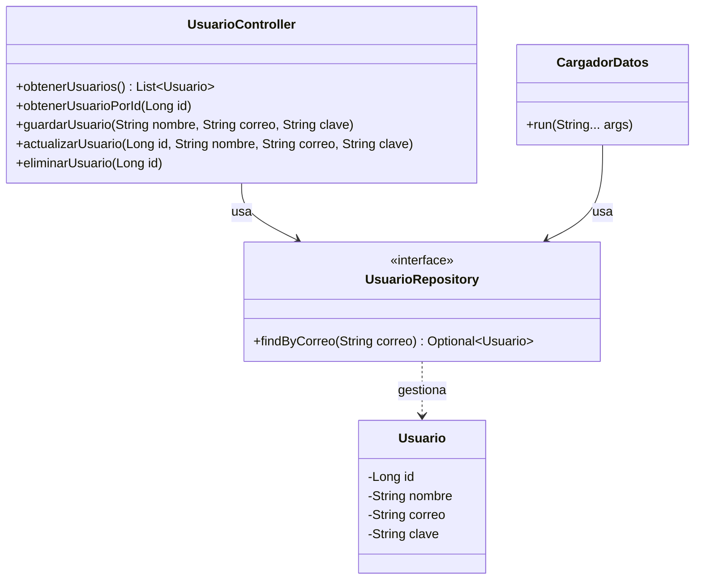

# spring_ADSO – Módulo de usuarios con Spring Boot

Evidencia **GA7-220501096-AA3-EV01** – Codificación de módulos del software.
Módulo de **usuarios** de la tienda, construido con **Spring Boot**, **Spring Data JPA (Hibernate)** y **MySQL**.

## Qué hace

- Crea la base de datos y la tabla `usuarios` automáticamente si no existen.
- Carga tres usuarios iniciales al arrancar (`CargadorDatos`), solo si la tabla está vacía.
- Expone un controlador REST con las operaciones **obtener, guardar, actualizar y eliminar**.

## Tecnologías

| Tecnología | Uso |
|---|---|
| Java 21 | Lenguaje |
| Spring Boot 4.1.1 | Framework principal |
| Spring Data JPA / Hibernate | Acceso a la base de datos |
| MySQL (XAMPP) | Base de datos |
| Lombok | Menos código repetitivo (getters, setters, constructores) |
| Gradle (incluye wrapper) | Construcción del proyecto |

## Cómo ejecutarlo

1. Iniciar **MySQL** en XAMPP (usuario `root`, sin contraseña). Si tu MySQL es distinto, se cambia en `src/main/resources/application.properties`.
2. En la carpeta del proyecto, ejecutar:
   ```
   .\gradlew.bat bootRun
   ```
   (La primera vez descarga dependencias; se necesita internet.) También se puede abrir la carpeta en VS Code y ejecutar la clase `SpringAdsoApplication`.
3. La consola debe mostrar `Datos iniciales cargados: 3 usuarios`.
4. Abrir `http://localhost:8080/usuarios/todos`.

## Rutas del controlador (ruta base `/usuarios`)

| Operación | Ruta | Ejemplo |
|---|---|---|
| Obtener todos | `/usuarios/todos` | `http://localhost:8080/usuarios/todos` |
| Obtener por id | `/usuarios/buscar/{id}` | `http://localhost:8080/usuarios/buscar/1` |
| Guardar | `/usuarios/guardar?nombre=&correo=&clave=` | `http://localhost:8080/usuarios/guardar?nombre=Ana&correo=ana@correo.com&clave=1234` |
| Actualizar | `/usuarios/actualizar/{id}?nombre=&correo=&clave=` | `http://localhost:8080/usuarios/actualizar/1?nombre=AdminTienda&correo=admin@tienda.com&clave=4321` |
| Eliminar | `/usuarios/eliminar/{id}` | `http://localhost:8080/usuarios/eliminar/3` |

Respuestas de error: `404` si el id no existe y `409` si el correo ya está registrado.

## Estructura

```
src/main/java/com/example/spring_ADSO/
  SpringAdsoApplication.java   Clase principal que arranca la aplicación
  Usuario.java                 Entidad (tabla usuarios)
  UsuarioRepository.java       Repositorio (extiende JpaRepository)
  UsuarioController.java       Controlador REST
  CargadorDatos.java           Carga los usuarios iniciales al arrancar
src/main/resources/application.properties   Conexión a MySQL y configuración de JPA
src/test/java/...                           Prueba básica de arranque
build.gradle                                Dependencias y versiones
base_datos.sql                              Script SQL opcional
```

## Diagrama de clases del módulo



## Estándares de codificación aplicados

- Clases en `PascalCase`, métodos y variables en `camelCase`, nombres descriptivos en español.
- Comentarios Javadoc en cada clase y método público, y comentarios cortos en las líneas importantes.
- Sangrado de 4 espacios y una sola clase por archivo.
- Operaciones del controlador con el mismo patrón: ruta base `/usuarios` + ruta final por operación.

## Notas

- Guardar, actualizar y eliminar usan `GET` para poder probarlos desde el navegador. En una API real se usarían `POST`, `PUT` y `DELETE`.
- Las contraseñas se guardan en texto plano solo con fines de aprendizaje; en un sistema real se cifrarían.
- La prueba automática (`gradlew test`) requiere MySQL encendido.
